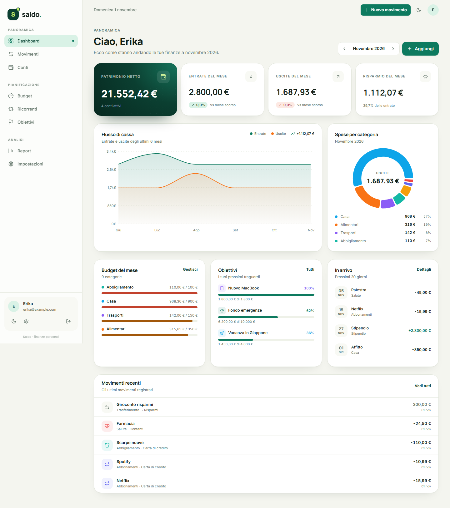
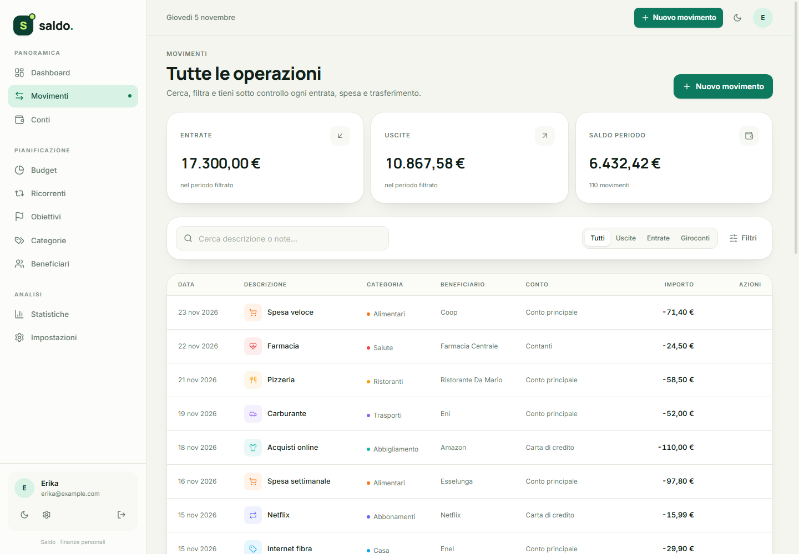
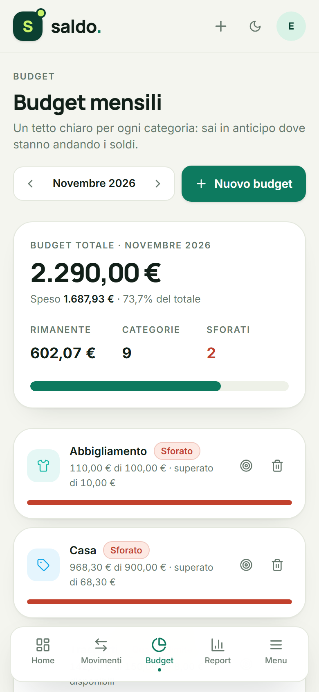
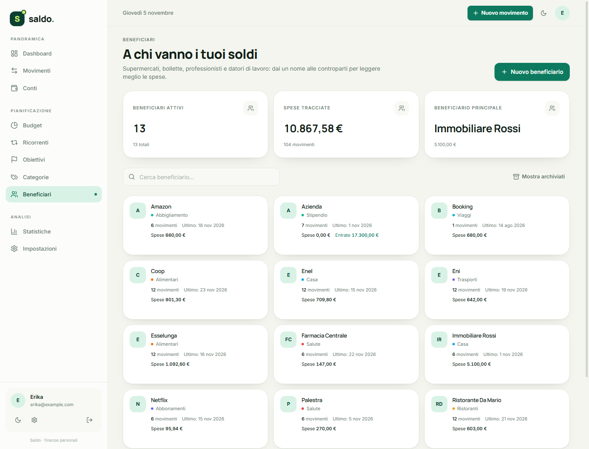
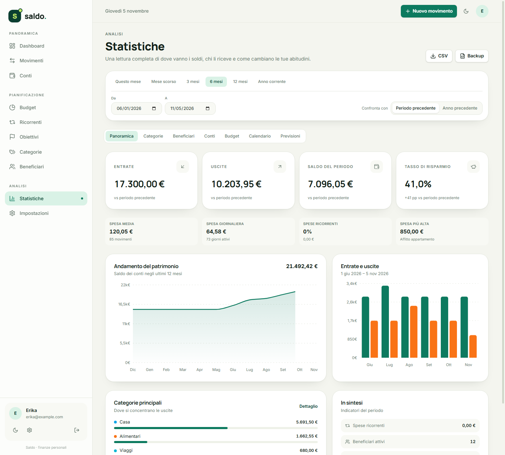
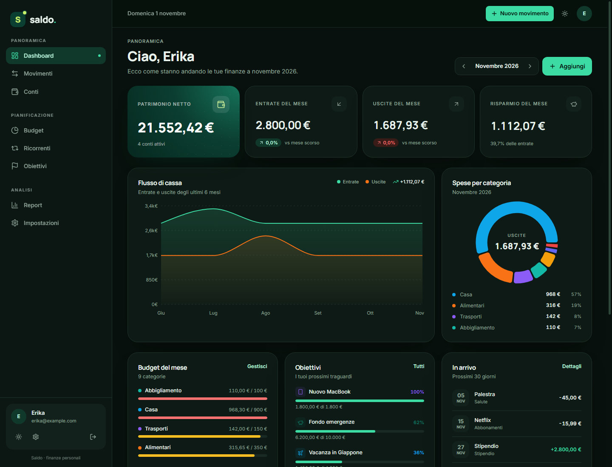

# Saldo

**Saldo** è una web app self-hosted per gestire le finanze personali con un'interfaccia moderna, pensata per desktop e mobile. Conti, movimenti, budget, ricorrenze, obiettivi e report in un unico posto, con i dati che restano sul tuo computer.



## Funzionalità

- **Conti multipli** — conto corrente, risparmio, contanti, carta di credito, investimenti; saldo calcolato automaticamente, archiviazione e saldo iniziale.
- **Movimenti** — entrate, spese e trasferimenti tra conti, categorie personalizzabili, note, ricerca e filtri per periodo, conto, categoria e beneficiario.
- **Beneficiari** — rubrica di negozi, fornitori, datori di lavoro e altre controparti, con categoria predefinita e statistiche dedicate. I campi di descrizione e beneficiario propongono le voci usate di recente.
- **Trasferimenti rapidi** — trasferimenti tra conti con modelli “Prelievo contanti” e “Versamento contanti”.
- **Budget mensili** — tetto di spesa per categoria, avanzamento in tempo reale, alert di sforamento, copia dei budget dal mese precedente.
- **Ricorrenze e previsioni** — stipendio, affitto, abbonamenti; registrazione automatica o manuale e previsione di cassa dei prossimi 3 mesi.
- **Obiettivi di risparmio** — traguardi con versamenti, anello di avanzamento e ritmo mensile necessario.
- **Statistiche** — panoramica con confronto periodo/anno precedente, categorie, beneficiari, conti e matrice trasferimenti, budget vs effettivo, calendario delle spese e previsioni.
- **Backup** — esportazione CSV dei movimenti e backup JSON completo.
- **Sicurezza** — account singolo con password protetta da Argon2 e sessione JWT; database SQLite locale.
- **Design** — Tailwind CSS 4, tema chiaro/scuro, layout responsive con sidebar su desktop e bottom navigation su mobile.

## Stack

| Livello | Tecnologie |
| --- | --- |
| Frontend | React 19, TypeScript, Vite 7, Tailwind CSS 4, TanStack Query, Recharts, Lucide |
| Backend | Python 3.12+, FastAPI, SQLAlchemy 2, Pydantic 2, Uvicorn |
| Database | SQLite (WAL, foreign key attive) |
| Tooling | uv per Python, npm per il frontend, pytest per i test |

## Avvio rapido

### Prerequisiti

- [uv](https://docs.astral.sh/uv/) installato
- Node.js 20+ e npm
- Windows, macOS o Linux

### Avvio in produzione (un solo server)

```powershell
.\start.ps1
```

Lo script installa le dipendenze se mancano, compila il frontend **solo quando serve** e avvia FastAPI su `http://127.0.0.1:8000`. Al primo accesso ti verrà chiesto di creare l'account.

La build viene saltata se `frontend/dist` è già aggiornato rispetto ai sorgenti: ai lanci successivi l'avvio è quasi immediato. Viene rifatta automaticamente quando modifichi file in `frontend/src`, `frontend/public`, `index.html`, `package.json` o la configurazione di Vite.

Opzioni:

```powershell
.\start.ps1 -Port 8080        # porta diversa
.\start.ps1 -ForceBuild       # forza la ricompilazione del frontend
.\start.ps1 -SkipBuild        # salta la build (deve esistere già dist/index.html)
```

### Avvio manuale

```powershell
# 1. Backend
cd backend
uv sync
uv run uvicorn app.main:app --host 127.0.0.1 --port 8000

# 2. Frontend (in un altro terminale)
cd frontend
npm install
npm run build
```

FastAPI serve automaticamente `frontend/dist` sulla stessa porta: non serve un web server separato.

### Sviluppo con hot reload

```powershell
.\dev.ps1
```

Oppure manualmente:

```powershell
# Terminale 1 — API con reload
cd backend
uv run uvicorn app.main:app --reload --port 8000

# Terminale 2 — Vite con proxy /api
cd frontend
npm run dev
```

L'app di sviluppo è su `http://127.0.0.1:5173`; Vite inoltra le chiamate `/api` al backend sulla porta 8000.

### Docker e Portainer

Sono inclusi `Dockerfile`, `docker-compose.yml` e `.dockerignore`, oltre alla guida [deploy/PORTAINER.md](deploy/PORTAINER.md).

```powershell
docker compose up -d --build
```

L'app sarà su `http://127.0.0.1:8090`; i dati stanno nel volume nominato `saldo_data`. Il container gira come utente non-root, ha un healthcheck e riavvio automatico. La porta `8090` è la porta host, mappata alla `8000` interna del container.

Variabili principali:

```text
SALDO_JWT_SECRET=...                  # consigliata in produzione
SALDO_ACCESS_TOKEN_EXPIRE_MINUTES=10080
SALDO_PORT=8090                       # la 8000 è già occupata sulla VM
SALDO_BIND_IP=0.0.0.0                 # Caddy esterno raggiunge l'host su 8090
TZ=Europe/Rome
```

Il container pubblica la porta `8090` sull'host Docker `192.168.1.11`; il Caddy già presente nel homelab deve fare `reverse_proxy 192.168.1.11:8090`. Limita la porta con il firewall all'IP di Caddy: l'unica porta pubblica deve essere quella di Caddy (80/443).

Per Portainer: **Stacks → Add stack → Repository**, URL del repository, branch `main`, compose path `docker-compose.yml`. I dettagli, incluso il reverse proxy e il backup del volume, sono in [deploy/PORTAINER.md](deploy/PORTAINER.md).

## Primo utilizzo

1. Apri l'app e crea l'account (nome, email, password di almeno 8 caratteri).
2. Aggiungi almeno un conto da **Conti**.
3. Registra il primo movimento da **Movimenti**.
4. Imposta i budget da **Budget** e, se vuoi, una ricorrenza per stipendio o affitto.

Le categorie di spesa e di entrata più comuni sono già presenti e possono essere personalizzate.

## Dati e backup

- Database: `backend/data/saldo.db`
- Segreto JWT generato al primo avvio: `backend/data/.secret`
- Export: **Impostazioni → Dati e backup** (CSV dei movimenti o backup JSON completo)
- Azzeramento: **Impostazioni → Zona pericolosa** richiede password e la parola `ELIMINA`

### Migrazioni

Il backend applica automaticamente le migrazioni additive all'avvio (tabella `schema_migrations`). L'introduzione dei beneficiari aggiunge `payees`, `transactions.payee_id` e `recurring_transactions.payee_id` senza toccare i movimenti esistenti.

Prima di aggiornare un'installazione con dati reali, fai un backup del volume `saldo_data` o del file `backend/data/saldo.db`. La migrazione è idempotente: può essere eseguita più volte senza creare duplicati.

Per spostare l'app su un altro computer è sufficiente copiare la cartella `backend/data` (a app spenta) e il progetto.

## Configurazione

Le variabili d'ambiente usano il prefisso `SALDO_` e possono essere definite in `backend/.env` (vedi `backend/.env.example`):

| Variabile | Descrizione |
| --- | --- |
| `SALDO_JWT_SECRET` | Chiave di firma JWT. Se vuota, viene generata e salvata in `backend/data/.secret`. |
| `SALDO_ACCESS_TOKEN_EXPIRE_MINUTES` | Durata della sessione in minuti. Default `43200` (30 giorni). |
| `SALDO_DATABASE_URL` | URL SQLAlchemy del database. Default: SQLite in `backend/data/saldo.db`. |
| `SALDO_CORS_ORIGINS` | Lista JSON di origini consentite (utile solo in sviluppo). |

## Esporre Saldo in rete con Caddy

Saldo è progettato per `localhost`. Se vuoi raggiungerlo da fuori, l'ordine corretto è: segreto JWT stabile, backend raggiungibile solo dal reverse proxy, Caddy con HTTPS e, se possibile, una VPN o un livello di autenticazione aggiuntivo.

> Se usi Docker/Portainer con Caddy in un LXC separato, segui [deploy/PORTAINER.md](deploy/PORTAINER.md): il container pubblica `8090` sull'host Docker e Caddy usa `reverse_proxy 192.168.1.11:8090`. La parte seguente descrive l'installazione bare-metal con Caddy sullo stesso host.

### 1. Token di sessione e segreto JWT

Sono due cose diverse:

- il **JWT di sessione** viene creato al login, salvato nel browser (`localStorage`) e inviato a ogni chiamata come `Authorization: Bearer <token>`;
- il **segreto JWT** (`SALDO_JWT_SECRET`) è la chiave con cui il backend firma e verifica i token. Non viene mai inviato al browser e Caddy non deve conoscerlo.

In locale va bene il segreto generato automaticamente in `backend/data/.secret`. Per un'esposizione in rete impostane uno esplicito e stabile:

```powershell
cd backend
uv run python -c "import secrets; print(secrets.token_urlsafe(64))"
```

Copia il valore in `backend/.env`:

```dotenv
SALDO_JWT_SECRET=incolla_qui_il_valore_generato
SALDO_ACCESS_TOKEN_EXPIRE_MINUTES=10080
```

Poi riavvia Saldo.

- Se cambi il segreto, **tutti i token esistenti diventano invalidi** e i browser tornano alla schermata di login.
- Non committare `.env`: è già nel `.gitignore`.
- Se perdi il segreto i dati restano intatti, ma le sessioni vengono invalidate.
- Se il segreto viene compromesso, cambialo subito e cambia anche la password.
- Il default di 30 giorni è comodo in locale; su Internet meglio 1-7 giorni (`1440` o `10080` minuti).
- Cambiare la password **non** revoca i JWT già emessi: per revocare tutte le sessioni ruota il segreto.

Se `SALDO_JWT_SECRET` non è impostato, Saldo usa `backend/data/.secret`, generato al primo avvio. Includilo nel backup insieme al database.

### 2. Backend solo su localhost

`start.ps1` avvia già Uvicorn su `127.0.0.1:8000`. Non usare `--host 0.0.0.0` e non aprire la porta 8000 sul firewall: l'unica porta pubblica deve essere quella di Caddy (80/443).

### 3. Caddy

Copia [deploy/Caddyfile.example](deploy/Caddyfile.example) in `C:\caddy\Caddyfile`, sostituisci `saldo.example.com` con il tuo dominio e avvia:

```powershell
caddy run --config C:\caddy\Caddyfile --adapter caddyfile
```

Il dominio deve avere un record DNS verso il server e le porte 80/443 devono essere raggiungibili: Caddy ottiene e rinnova il certificato HTTPS da solo.

Il Caddyfile d'esempio:

- inoltra `Authorization` senza rimuoverlo;
- aggiunge `Cache-Control: no-store` alle API;
- blocca `/docs`, `/redoc` e `/openapi.json` in produzione;
- aggiunge header di sicurezza e limita il corpo delle richieste.

### 4. Basic Auth: attenzione all'header `Authorization`

Se aggiungi `basic_auth` a Caddy, **non applicarlo a `/api/*`**. L'app invia `Authorization: Bearer ...`, mentre Basic Auth si aspetta `Authorization: Basic ...`: Caddy risponderebbe `401` a tutte le chiamate API.

Nel Caddyfile d'esempio il blocco è commentato e usa:

```caddyfile
@ui {
    not path /api/*
}
basic_auth @ui {
    erika $2a$14$...
}
```

Genera l'hash con:

```powershell
caddy hash-password --plaintext 'una-password-lunga-e-casuale'
```

Tieni presente che questo protegge solo l'interfaccia e gli asset: le API restano protette dal login di Saldo. Per un'autenticazione proxy più solida usa Authelia o authentik con `forward_auth` e cookie, oppure una VPN.

### 5. Alternative e buone pratiche

- **VPN (Tailscale, WireGuard)**: è la soluzione più sicura per dati finanziari, non richiede porte pubbliche e puoi comunque usare Caddy o HTTPS locale.
- **Rate limiting**: Saldo non limita i tentativi di login. Se lo esponi pubblicamente, aggiungi Cloudflare, CrowdSec o fail2ban, oppure un'allow-list di IP.
- **Backup** di `backend/data/saldo.db` e del segreto (`.env` o `.secret`) prima di modificare l'infrastruttura.
- **HSTS** solo dopo aver verificato che HTTPS funzioni correttamente.
- **Log**: non registrare mai l'header `Authorization` nei log del proxy.

### 6. CORS

Con Caddy sulla stessa origine lascia `SALDO_CORS_ORIGINS` ai valori predefiniti e non usare `*`. Se separi frontend e API su domini diversi, elenca solo le origini esatte, in formato JSON.

## Problemi comuni

### La build del frontend fallisce con `Access denied` su un file `esbuild-...`

Su Windows la cartella temporanea di sistema può essere bloccata da antivirus, criteri aziendali o dalla sandbox dell'ambiente. `start.ps1` e `dev.ps1` ora usano una cartella `.tmp` locale al progetto, quindi il problema non dovrebbe più comparire.

Se lanci la build manualmente:

```powershell
cd frontend
New-Item -ItemType Directory -Force -Path ..\.tmp | Out-Null
$env:TMP = (Resolve-Path ..\.tmp).Path
$env:TEMP = $env:TMP
npm run build
```

Se la build fallisce, `start.ps1` si interrompe e non avvia il backend con un frontend incompleto.

### La porta 8000 è già in uso

```powershell
Get-NetTCPConnection -LocalPort 8000 -State Listen |
  ForEach-Object { Stop-Process -Id $_.OwningProcess -Force }
```

Oppure avvia su un'altra porta: `.\start.ps1 -Port 8080`.

## API e test

- Documentazione interattiva: `http://127.0.0.1:8000/docs`
- Health check: `GET /api/health`
- Test backend:

```powershell
cd backend
uv run pytest
```

I test coprono autenticazione, conti, movimenti, trasferimenti, beneficiari, suggerimenti, budget, obiettivi, ricorrenze, dashboard, statistiche, export e reset dei dati.

## Struttura del progetto

```text
.
├─ backend/
│  ├─ app/
│  │  ├─ main.py          # FastAPI, static SPA e lifespan
│  │  ├─ models.py        # modelli SQLAlchemy
│  │  ├─ schemas.py       # schemi Pydantic
│  │  ├─ services.py      # saldi, budget, previsioni, aggregazioni
│  │  ├─ analytics.py     # statistiche, beneficiari, conti, calendario
│  │  ├─ migrations.py    # migrazioni SQLite idempotenti
│  │  ├─ serializers.py   # output API
│  │  └─ routers/         # auth, conti, categorie, beneficiari, movimenti, suggerimenti, budget, ricorrenti, obiettivi, statistiche, impostazioni
│  ├─ tests/
│  └─ data/               # database e segreto (non versionati)
├─ frontend/
│  ├─ src/
│  │  ├─ pages/           # dashboard, movimenti, conti, categorie, beneficiari, budget, ricorrenti, obiettivi, statistiche, impostazioni, login
│  │  ├─ components/      # layout, UI kit, grafici, modali, autocomplete
│  │  ├─ context/         # auth, tema, toast
│  │  └─ lib/             # client API, formattazione, utility, icone
│  └─ dist/               # build servita da FastAPI (non versionata)
├─ docs/screenshots/
├─ deploy/
│  ├─ Caddyfile.example
│  └─ PORTAINER.md
├─ Dockerfile
├─ docker-compose.yml
├─ .dockerignore
├─ start.ps1
├─ dev.ps1
└─ uv.toml
```

## Note su sicurezza e privacy

Saldo è progettato per uso personale su una macchina locale. Non effettua chiamate verso servizi esterni e non include analytics. Se decidi di esporlo in rete, segui la sezione [Esporre Saldo in rete con Caddy](#esporre-saldo-in-rete-con-caddy): HTTPS, `SALDO_JWT_SECRET` robusto, backend solo su `127.0.0.1` e, preferibilmente, una VPN o un'autenticazione proxy che non interferisca con l'header `Authorization` delle API.

## Screenshot

| Movimenti (desktop) | Budget (mobile) |
| --- | --- |
|  |  |

| Beneficiari | Statistiche |
| --- | --- |
|  |  |

| Tema scuro |
| --- |
|  |

---

Saldo 1.0.0 · FastAPI + React + SQLite
